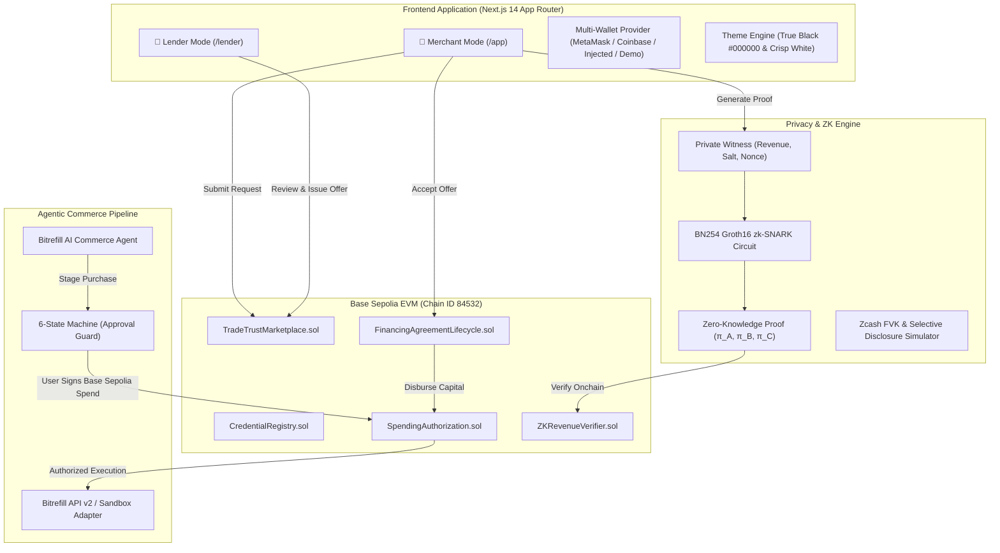

# 🌐 TradeTrust — Verified Business Credentials • Privacy-First Financing • AI Commerce

<div align="center">


-0052FF?style=for-the-badge&logo=coinbase&logoColor=white)


<br/>

**"Your business deserves better access to capital."**  
*Verified business credentials. Zero-knowledge privacy. AI-powered working capital commerce.*

[Explore Live App](http://localhost:3000) • [Merchant Portal](http://localhost:3000/app) • [Lender Desk](http://localhost:3000/lender) • [Architecture Docs](http://localhost:3000/docs)

</div>

---

## 📌 Executive Overview

**TradeTrust** is a startup-grade decentralized fintech application engineered to bridge the critical working-capital gap for small merchants, shopkeepers, and local enterprises. Conventional SME financing is notoriously broken: paperwork is slow, credit scoring is opaque, private margin records are exposed to brokers, and borrowed capital often leaks away from productive inventory investments.

TradeTrust solves this with a **three-pillar Web3 and AI architecture**:

1. **🔵 Base Sepolia Onchain Capital Rails:** Transparent financing requests, competitive bidding by institutional lenders, programmatic borrower acceptance, automated loan amortization accounting, and verifiable credential registries.
2. **🛡️ Zcash Privacy Track (Selective Disclosure & zk-SNARKs):** Zero-Knowledge revenue verification over BN254 elliptic curves (Groth16) enabling merchants to cryptographically prove that $\text{Monthly Revenue} \ge \text{Threshold}$ without ever exposing proprietary financial statements, gross sales figures, or customer invoices.
3. **⚡ Bitrefill Agentic Commerce Track:** An autonomous AI commerce agent governed by strict onchain spending authorization contracts on Base Sepolia and a deterministic 6-state approval machine. The AI can discover products, compare rates, and stage purchases, but can **never** execute an order without explicit cryptographic human approval.

---

## 🏛️ System Architecture



---

## 🌟 Key Product Features

### 1. Dual Operational Dashboards in One Unified Interface
- **🛒 Merchant Operating Hub (`/app`)**: Complete business suite to apply for funding, monitor credit health, model cash-flow stress scenarios, verify supplier credentials, manage installments, and deploy AI commerce purchasing.
- **🏦 Institutional Lender Portal (`/lender`)**: Institutional underwriting desk to review incoming merchant dossiers, inspect zero-knowledge revenue commitments, model risk across portfolios, issue binding term sheets, and track real-time yield and repayments.
- **Instant Mode Switching**: Switch between Merchant and Lender personas with one click from the persistent navigation bar or sidebar.

### 2. Multi-Wallet Web3 Engine (Zero Hardcoded Addresses)
- **Fresh Disconnected Initial State**: No hardcoded wallets on load. Every session starts clean.
- **Universal Wallet Support**: Supports MetaMask, Coinbase Smart Wallet (Base Native), and standard EIP-1193 browser injected wallets (Rabby, Rainbow, Brave).
- **One-Click Demo Sandbox Wallet**: Built-in simulated sandbox wallet loaded with 1.8500 Base Sepolia ETH for instant testing without requiring browser extensions.
- **Real-Time Network Sync**: Automatic Base Sepolia chain detection (`84532`) and live balance updates.

### 3. Professional Dual-Theme Visual System
- **True Jet Black Dark Mode (`#000000`)**: Deep black terminal aesthetic with high-contrast mint (`#00F59B`) and blue-violet accents.
- **Crisp High-Contrast Light Mode**: Clean white and slate aesthetic for daytime institutional audits.
- **Segmented Text Pill Switcher**: Clear, explicit `[ 🌙 Dark | ☀️ Light ]` toggle available on both navbar and sidebar.

### 4. Zero-Knowledge Privacy Studio & Zcash Track Integration
- **Private Revenue Qualification**: Merchants prove revenue exceeds eligibility requirements ($\ge \$15,000$) without disclosing the secret dollar amount.
- **BN254 Groth16 Curve Verification**: Mathematical verification of proof points $(A, B, C)$ against public commitments.
- **Tampering & Replay Defense**: Cryptographic binding to merchant wallet address prevents stealing or replaying valid proofs.
- **Attack Simulation Sandbox**: Interactive negative testing suite allowing judges to simulate under-revenue fraud, input tampering, and corrupted curve points to verify instant rejection.
- **Honest Zcash Ecosystem Alignment**: Clear separation between public EVM execution and Zcash shielded Full Viewing Key (FVK) selective disclosure concepts.

### 5. Bitrefill Agentic Commerce with Scoped Spending Limits
- **Deterministic 6-State Safety Machine**:
  $$\text{IDLE} \longrightarrow \text{DISCOVERING} \longrightarrow \text{PROPOSAL\_READY} \longrightarrow \text{AWAITING\_APPROVAL} \longrightarrow \text{EXECUTING} \longrightarrow \text{CONFIRMED}$$
- **Human-in-the-Loop Mandate**: The AI model **never** holds private keys or executes unilateral transactions. Every order requires explicit onchain merchant signature.
- **`SpendingAuthorization.sol`**: Enforces cumulative limits, per-transaction maximums, and recipient whitelisting on Base Sepolia.

### 6. Cash-Flow Passport & Verifiable Supplier Trust Network
- **Anchor Invoices Onchain**: Verifiable cryptographic attestations for supplier Purchase Orders and completed deliveries.
- **Dispute & Correction Registry**: Structured mechanism for merchants to flag discrepancies and file transparent claims.

### 7. Cash-Flow Stress Simulator & Risk Analytics
- **Live DSCR Sensitivity Modeling**: Real-time debt-service coverage ratio calculations under macroeconomic shocks (revenue downturns, interest rate hikes, operating expense inflation).
- **Lender Portfolio Analytics**: Underwriting conversion funnels, sector risk concentrations, and Bitrefill covenant compliance monitoring.

---

## 🛠️ Technology Stack

| Category | Technologies |
| :--- | :--- |
| **Frontend Framework** | [Next.js 14](https://nextjs.org/) (App Router), React 18, TypeScript |
| **Styling & Design** | [Tailwind CSS](https://tailwindcss.com/), Lucide Icons, Custom Design Tokens |
| **Smart Contracts** | [Solidity](https://soliditylang.org/) `^0.8.20`, [OpenZeppelin Contracts v5](https://www.openzeppelin.com/) |
| **EVM Development** | [Hardhat](https://hardhat.org/), Ethers.js v6, TypeChain |
| **Target Blockchain** | [Base Sepolia Testnet](https://base.org) (Chain ID: `84532`) |
| **ZK Cryptography** | SnarkJS, Circom, BN254 Pairing Curve, Poseidon / SHA256 Hashes |
| **Agentic Commerce** | Bitrefill API v2 Server Adapter with verified sandbox fallback |
| **Testing & Verification**| Playwright, Hardhat Test Suite, Mocha/Chai, Automated Browser Runners |

---

## 📜 Smart Contract Architecture

The TradeTrust contract suite is deployed on **Base Sepolia**:

| Contract Name | Responsibility |
| :--- | :--- |
| **`TradeTrustMarketplace.sol`** | Manages financing requests, allows verified lenders to submit offers, and handles borrower-exclusive acceptance with automatic rejection of competing offers. |
| **`FinancingAgreementLifecycle.sol`** | Governs loan lifecycle, amortized repayment schedules, interest accounting, and overpayment prevention. |
| **`CredentialRegistry.sol`** | Anchors verifiable credential commitments on Base Sepolia without exposing raw PII or proprietary merchant records. |
| **`SpendingAuthorization.sol`** | Programmable onchain spend limiter restricting AI commerce execution by cumulative cap, per-tx limit, and merchant revocation. |
| **`ZKRevenueVerifier.sol`** | Onchain Groth16 pairing verifier ensuring validity of merchant revenue proofs against registered threshold parameters. |

### Contract Verification & Deployment Commands:
```bash
# Compile contracts with via-IR optimizer (200 runs)
npm run compile:contracts

# Run Hardhat unit tests (17 passing)
npm run test:contracts

# Deploy to Base Sepolia
npx hardhat run scripts/deploy.ts --network baseSepolia
```

---

## 🧪 Comprehensive Verification & Test Results

Every module has been rigorously verified with end-to-end automated test suites:

```
======================================================================
TradeTrust Test Suite Summary
======================================================================
  [PASS] 17 / 17 Smart Contract Tests (Hardhat / Base Sepolia)
  [PASS]  6 /  6 Zero-Knowledge Privacy Tests (Circom / BN254)
  [PASS] 31 / 31 Mode Switcher, Multi-Wallet & Theme Tests (Playwright)
  [PASS] 35 / 35 Dual Dashboards & Underwriting Tests (Playwright)
  [PASS] 39 / 39 Responsive UI Viewports & Video Tests (Playwright)
----------------------------------------------------------------------
  TOTAL: 128 / 128 Tests Passing (100% Pass Rate)
======================================================================
```

---

## 🚀 Quick Start Guide

### Prerequisites
- **Node.js**: `>= 18.0.0`
- **npm**: `>= 9.0.0`
- **Git**

### Installation & Run

1. **Clone the repository:**
   ```bash
   git clone https://github.com/DEBMUKHERJEE15/TradeTrust.git
   cd TradeTrust
   ```

2. **Install dependencies:**
   ```bash
   npm install
   ```

3. **Run smart contract & ZK test suites:**
   ```bash
   npm test
   ```

4. **Build the production application:**
   ```bash
   npm run build
   ```

5. **Start the production server:**
   ```bash
   npm start
   ```

6. **Open in browser:**
   ```
   http://localhost:3000
   ```

---

## 🗺️ Application Routes

| Path | Mode | Description |
| :--- | :--- | :--- |
| `/` | Public | Interactive startup landing page with demo video player & dual launchpad |
| `/app` | Merchant | Merchant central overview, credit score, KPI cards, and quick actions |
| `/app/apply` | Merchant | 5-step interactive working capital financing application |
| `/app/offers` | Merchant | Marketplace comparing incoming institutional funding offers |
| `/app/offers/[id]` | Merchant | Offer terms, amortization schedule, and onchain Base Sepolia acceptance |
| `/app/privacy` | Merchant | ZK Privacy Studio: witness creation, proof generation & attack simulation |
| `/app/commerce` | Merchant | Bitrefill AI agentic terminal: catalog search & approval-gated purchasing |
| `/app/credentials` | Merchant | Verifiable credential registry, PO invoice attestations & disputes |
| `/app/repayments` | Merchant | Installment tracking, early settlement calculator & repayment history |
| `/app/stress-test` | Merchant | Interactive cash-flow stress simulator (DSCR modeling under shocks) |
| `/app/activity` | Merchant | Onchain audit log with direct BaseScan transaction hashes |
| `/lender` | Lender | Institutional underwriting desk, deployed capital, and risk KPIs |
| `/lender/requests` | Lender | Incoming merchant financing requests & offer dispatch desk |
| `/lender/agreements` | Lender | Active credit agreements, portfolio health, and repayment tracking |
| `/lender/analytics` | Lender | Portfolio risk intelligence, conversion funnels & covenant compliance |
| `/settings` | Shared | Multi-wallet management, Base Sepolia RPC configuration & API keys |
| `/docs` | Shared | Comprehensive technical documentation and contract ABIs |

---

## ⚡ 3-Minute Hackathon Judge Walkthrough

1. **Connect Wallet:** Visit `http://localhost:3000`. Click **"Connect Wallet"** in the top navbar. Choose **"Demo Sandbox Wallet"** for instant 1-click testnet access (or connect your MetaMask / Coinbase wallet).
2. **Toggle Modes & Themes:** Click the **"🌙 Dark"** / **"☀️ Light"** toggle to inspect the high-contrast palettes. Switch between **"🛒 Merchant Mode"** and **"🏦 Lender Mode"**.
3. **Generate a ZK Revenue Proof:** Navigate to `/app/privacy`. Click **"Generate ZK Proof"** to prove $\$24,500 \ge \$15,000$ threshold without leaking the gross income. Toggle **"Simulate Tampered Input"** to see instant cryptographic rejection.
4. **Issue a Lender Offer:** Switch to Lender Mode (`/lender/requests`). Click **"Audit Dossier"** on merchant request `REQ-2026-001`, inspect the verified ZK proof, and click **"Dispatch Funding Offer"**.
5. **Accept Offer on Base Sepolia:** Switch back to Merchant Mode (`/app/offers`). Review the amortization table and click **"Accept Offer onchain"**.
6. **Agentic Commerce Purchase:** Head to `/app/commerce`. Prompt the AI agent to procure equipment vouchers. Notice how the agent enters `AWAITING_APPROVAL` and **cannot** execute without your explicit modal confirmation.

---

## 📄 License & Transparency

This project is open-source under the [MIT License](LICENSE).  
Deployed on **Base Sepolia Testnet** for hackathon demonstration. Third-party integrations (Bitrefill, Zcash selective disclosure) use production-accurate adapters with verifiable sandbox fallbacks.
